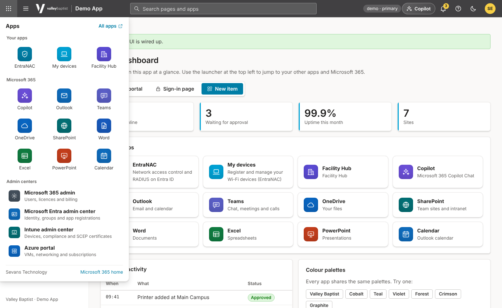
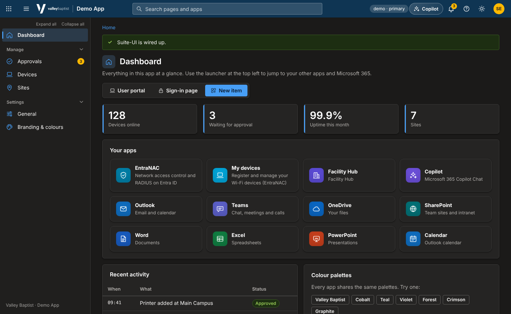
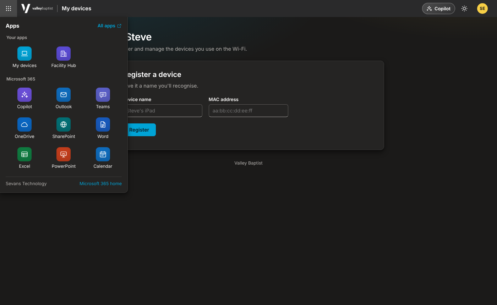
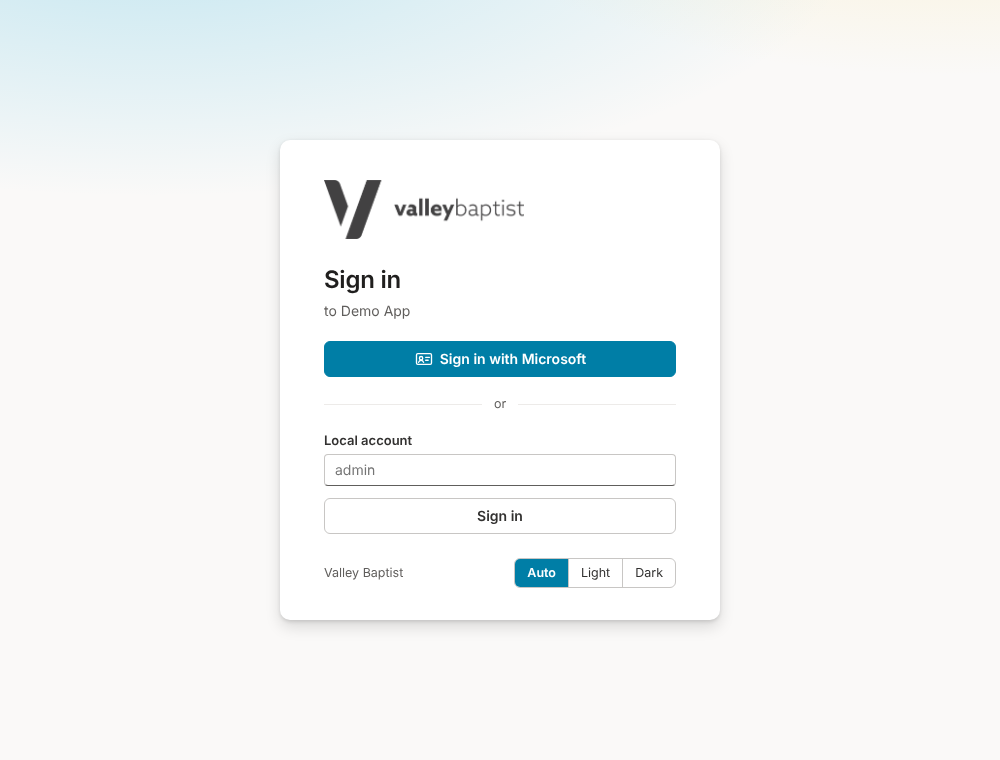

# Web Suite UI (Suite-UI)

The shared interface for Sevans Technology apps. It started as EntraNAC's interface and now lives here so every new
project gets the same Microsoft 365 / Copilot look and links to the others.

- **One look.** Fluent-style top bar, collapsible left menu, breadcrumbs, cards, tables, forms, badges, sign-in page and
  self-service portal layout. Light and dark, eighteen palettes (standard, fun and holiday; Valley Baptist by default),
  plus a custom palette built from one brand colour with WCAG 4.5:1 contrast. Admins set the app's colours; each user
  can pick their own in the user menu, and it follows them from app to app.
- **One navigation.** A Microsoft 365-style **app launcher** (the "waffle" at the top left) lists your apps, the
  Microsoft 365 apps and the admin centres. It reads one shared list, [`apps.json`](src/suite_ui/registry/apps.json),
  so adding a project there adds it to every app's launcher.
- **Feels like one product.** Top-bar search finds this app's pages *and* the other apps. The **Copilot** button opens
  Microsoft 365 Copilot. The light / dark choice follows the user from app to app.



| Dark mode, Cobalt palette | User portal (no admin centres) | Sign-in |
|---|---|---|
|  |  |  |

**Used by:** [EntraNAC](https://github.com/sevanstechnology/EntraNAC) (vendored copy, synced with its
`scripts/sync-suite-ui.sh` - see [docs/migrating-entranac.md](docs/migrating-entranac.md)) and
[Facility Hub](https://github.com/sevanstechnology/Facility-Hub) (Node app, static files - see [docs/using-from-node.md](docs/using-from-node.md)).

## Use it in a Python app (FastAPI / Starlette)

```bash
pip install "suite-ui @ git+https://github.com/sevanstechnology/Web-Suite-UI@v0.1.0"
```

```python
from fastapi import FastAPI
from fastapi.templating import Jinja2Templates
from suite_ui import Suite

app = FastAPI()
templates = Jinja2Templates(directory="app/templates")
suite = Suite(app_id="entranac", app_name="EntraNAC", org_name="Valley Baptist",
              app_urls={"facility-hub": "https://facilities.vbc.org/"})   # or SUITE_APP_URL_FACILITY_HUB=...
suite.mount(app, templates)          # serves /static/suite/* and adds the suite/ templates + `suite` global
```

Your app's `base.html` declares its menu and extends the shell:

```jinja


```

Pages extend `base.html` and fill ``. Pass `user`, `ui` (`suite.ui("cobalt")`), `flashes`,
`counts`, `notifications`, `help_links`, `signout_url` and `pill` in the template context as needed - all optional.
User-facing pages extend `suite/portal.html`, the sign-in page extends `suite/login.html`. See
[`examples/fastapi`](examples/fastapi) for all three.

Flask: `suite.init_flask(app)` instead of `mount()`.

## Use it without Python

Download `suite-ui-<version>.zip` from the [releases](../../releases), serve the files, and copy the markup from
[`examples/static-html/index.html`](examples/static-html/index.html). Point `data-suite-apps` on `<html>` at a
hosted copy of `apps.json` (it must allow CORS if it's on another domain) or embed it in a
`<script type="application/json" id="suite-apps">` block. Apps that draw their menu in the browser call
`SuiteUI.refresh()` after rendering (see [docs/using-from-node.md](docs/using-from-node.md)).

## Linking a new project into the suite

1. Add it to [`src/suite_ui/registry/apps.json`](src/suite_ui/registry/apps.json) (id, name, description, url,
   icon, colour, audience) and release a new version.
2. In the new project, create `Suite(app_id="<that id>", ...)`. Its own tile is highlighted and links to its home.
3. Each deployment sets the real URLs with `app_urls=` or `SUITE_APP_URL_<ID>` environment variables, so the
   registry can keep placeholder addresses.
4. To change the launcher everywhere without redeploying, host `apps.json` somewhere (SharePoint, a static site,
   any app) and set `SUITE_REGISTRY=https://…/apps.json` on each app; it's re-read every five minutes.

More detail: [docs/adding-an-app.md](docs/adding-an-app.md) · [docs/design.md](docs/design.md) ·
[docs/migrating-entranac.md](docs/migrating-entranac.md)

## Develop

```bash
pip install -e ".[dev]"
pytest
uvicorn examples.fastapi.app:app --reload      # http://127.0.0.1:8000  (try ?palette=violet)
```

Release: bump `VERSION` and `CHANGELOG.md`, then push a tag `vX.Y.Z`. The workflow attaches the wheel and the
static zip to a GitHub release.

## Notes

- The launcher uses original line icons on coloured tiles, not Microsoft's product logos, so the repository is safe
  to make public. Each tile is labelled with the product name.
- `static/suite/brand/` holds the Valley Baptist logos used as defaults. Pass `logos={...}` to `Suite` (or call
  `suite.set_logos(...)`) to use an app's own uploaded logos, as EntraNAC's Branding page does.
